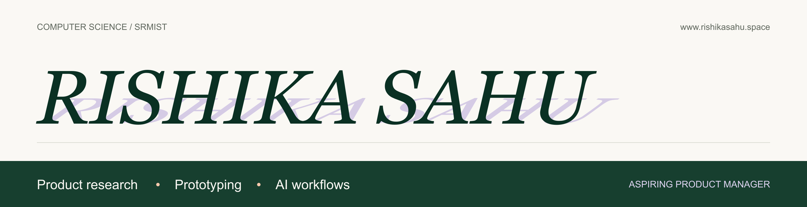

I'm **Rishika Sahu**, a fourth-year Computer Science undergraduate at **SRM Institute of Science and Technology, Chennai**, and an aspiring product manager. I've completed NextLeap's Product Manager Fellowship.

My projects cover user research, prioritisation, prototyping, and AI workflows. I'm interested in understanding where people get stuck and designing products that make the next step easier to understand.

  

## Skills & Tools

- **Research & design:** User research, usability testing, journey mapping, service blueprinting, Figma, FigJam
- **Product:** Feature prioritisation, product requirements, MVP scoping, metric definition
- **AI & workflows:** Prompt design, RAG, source verification, human approval flows, n8n, Gemini
- **Data & delivery:** Excel, Google Sheets, GitHub, Vercel

## Featured Projects

### PlacementOS — Opportunity Decision Platform
A functional MVP for students comparing job opportunities and planning limited preparation time. The ranking considers deadlines, application stage, requirement fit, skill gaps, and user preferences. Students can edit their priorities and preparation hours and review the reasoning behind the plan.

  
  
  

### Mutual Fund Assistant — Facts-Only RAG Prototype
An independent feature concept for Groww that answers questions about selected HDFC mutual fund schemes using official sources. The project defines which questions the assistant should answer or decline and how it should cite its sources. It provides fund facts, not investment recommendations.

  
  
  

### Review Intelligence — Customer Review Workflow
An n8n and Gemini workflow that processes public ChatGPT reviews into product themes, supporting quotes, and a sourced support clarification. A human approval step controls updates to a Google Docs log and the creation of a Gmail draft. The workflow does not send the email automatically.

  

More product studies: [ExchangeCheck](https://www.rishikasahu.space/projects/exchangecheck), a review flow for revised device-exchange quotes, and [Return Recovery](https://www.rishikasahu.space/projects/return-recovery), a recovery flow for failed marketplace pickups.

---

  
  
  

